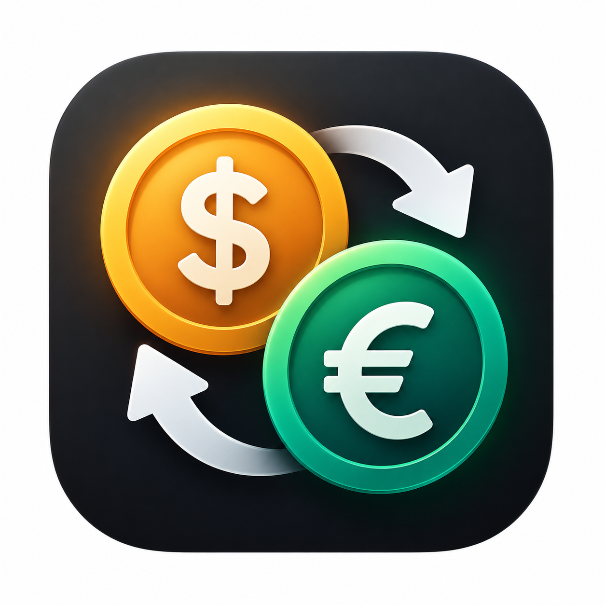

<p align="center">
  
</p>

<h1 align="center">currency_converter</h1>

<p align="center">
  A modern, responsive Flutter application for real-time global currency conversion and live exchange rate tracking.
</p>

<p align="center">
  
  
  
  
  
</p>

---

## 📱 App Screenshots

<table>
  <tr>
    <td align="center" width="50%">
      <br>
      <b>Main Conversion Screen</b><br>
      <sub>Live exchange rates and default USD to EGP conversion</sub>
    </td>
    <td align="center" width="50%">
      <br>
      <b>Currency Selection</b><br>
      <sub>Comprehensive list with country flags and currency codes</sub>
    </td>
  </tr>
  <tr>
    <td align="center" width="50%">
      <br>
      <b>Currency Swapping</b><br>
      <sub>One-tap instant currency swap (AED to EGP)</sub>
    </td>
    <td align="center" width="50%">
      <br>
      <b>Custom Amount Calculation</b><br>
      <sub>Real-time currency conversion for custom values</sub>
    </td>
  </tr>
</table>

---

## 📖 About

**`currency_converter`** is a clean, feature-rich Flutter application designed to perform accurate
global currency conversions instantly using live exchange rate data. Built following the MVVM
architecture with Provider for state management and `flutter_screenutil` for screen responsiveness,
the app provides a smooth user experience complete with country flag emojis, dynamic currency
dropdowns, real-time calculation, and rate updates powered by ExchangeRate-API.

---

## ✨ Features

- **Real-Time Exchange Rates**
    - Live exchange rate fetching powered by ExchangeRate-API via REST end-points.
    - Automatic calculation of converted amounts based on current market rates.
- **Extensive Currency Support & National Flags**
    - Supports over 160 world currencies with ISO codes, full names, and country flag emojis.
    - Interactive searchable dropdown selector for smooth navigation.
- **Instant Bidirectional Swapping**
    - Swap source and target currencies in one click with smooth state handling.
    - Immediately refetches and recalculates updated conversion rates.
- **Live Rate Banner & UTC Timestamps**
    - Displays clear rate equivalencies (e.g., `1 USD = 51.0072 EGP`).
    - Shows UTC last updated timestamp along with live status indicator.
- **Pixel-Perfect Responsive Design**
    - Scaled UI design adapted for multiple device screen sizes using `flutter_screenutil`.
    - Custom UI elements including coin graphics, architectural landmark illustrations, and card
      layouts.

---

## 🛠️ Technologies Used

- **[Flutter](https://flutter.dev)** (`v3.38.0` SDK / Dart `^3.11.5`): Core cross-platform app
  framework.
- **[provider](https://pub.dev/packages/provider)** (`v6.1.5+1`): State management using
  `ChangeNotifier` and `ChangeNotifierProvider`.
- **[http](https://pub.dev/packages/http)** (`v1.6.0`): REST API client used to fetch live exchange
  rate payloads.
- **[flutter_screenutil](https://pub.dev/packages/flutter_screenutil)** (`v5.9.3`): UI adaptation
  library for screen scaling and responsive sizing.
- **[easy_localization](https://pub.dev/packages/easy_localization)** (`v3.0.8`):
  Internationalization and localization framework.
- **[cupertino_icons](https://pub.dev/packages/cupertino_icons)** (`v1.0.9`): iOS-styled icons
  integration.
- **[flutter_lints](https://pub.dev/packages/flutter_lints)** (`v6.0.0`): Development code analysis
  and style enforcement rules.

---

## 📁 Project Structure

```text
lib/
├── Controllers/
│   └── currency_controller.dart # Provider state controller managing conversion logic & API state
├── api_service/
│   └── api_service.dart        # REST API service connecting to ExchangeRate-API
├── constants/
│   ├── Coin.dart               # Visual circular coin widget illustration
│   ├── Flag_constant.dart      # Map linking currency codes to flag emojis
│   ├── Landmark.dart          # Architectural icon widgets used in footer
│   └── currency_constants.dart # Complete mapping of currency codes, names, and flags
├── models/
│   └── currency_model.dart     # Data model for ExchangeRate API JSON response
├── screens/
│   └── CurrencyConverterScreen.dart # Main screen assembly with reactive UI components
├── widgets/
│   ├── CurrencyCard.dart       # Input card widget for currency selection and amount input
│   ├── CurrencyDropdown.dart   # Custom dropdown widget for currency selection
│   ├── ExchangeRateCard.dart   # Card displaying current conversion rate & last update time
│   ├── SwapButton.dart         # Circular action button triggering currency swap
│   ├── bottomSection.dart      # Footer layout displaying landmarks and developer banner
│   ├── convert_button.dart     # Conversion action button with loading state support
│   └── header.dart             # Header banner featuring title and coin stack graphics
└── main.dart                   # Application entry point with ScreenUtil & Provider initialization
```

---

## 🔮 Future Improvements

- [ ] **Offline Mode & Caching**: Local exchange rate caching via `shared_preferences` or `hive` to
  enable offline conversions.
- [ ] **Historical Exchange Rate Charts**: Graphical visualization of currency trends over 7 days,
  30 days, or 1 year.
- [ ] **Secure API Key Management**: Store API key securely via environment variables (
  `--dart-define` or `flutter_dotenv`).
- [ ] **Favorites & Multi-Currency Converter**: Support saving favorite currency pairs and
  converting across multiple currencies simultaneously.
- [ ] **Dark Theme**: Add dynamic dark mode theme support.
- [ ] **Unit & UI Test Suite**: Implement comprehensive unit tests for `CurrencyController` and
  widget tests for conversion flows.

---

## 👤 Author

**Ahmed Abbas** | Flutter Mobile Application Developer | Computer Science Student

- **GitHub:** [https://github.com/ahmedabbas06](https://github.com/ahmedabbas06)
- **LinkedIn:** [https://github.com/ahmedabbas06](https://www.linkedin.com/in/ahmed-abdullah-abbas)
