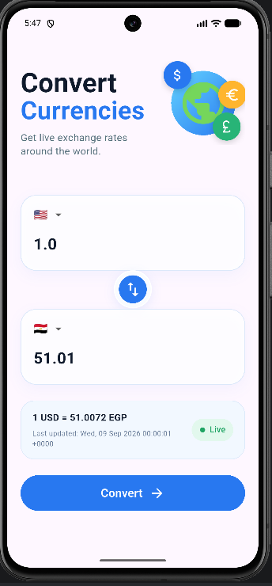
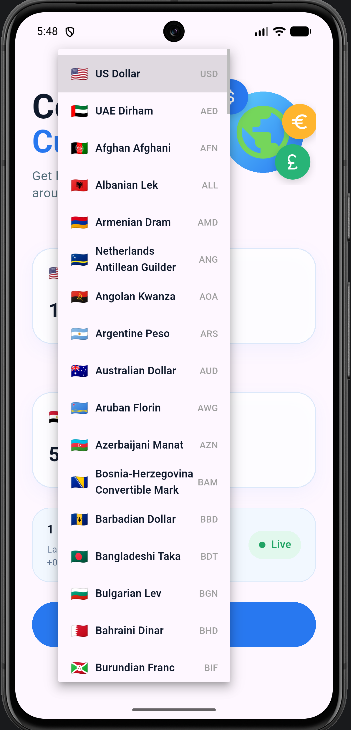
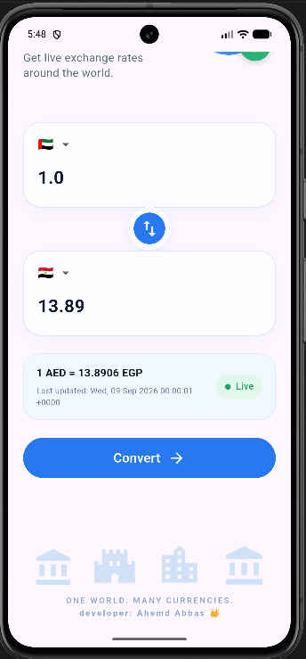
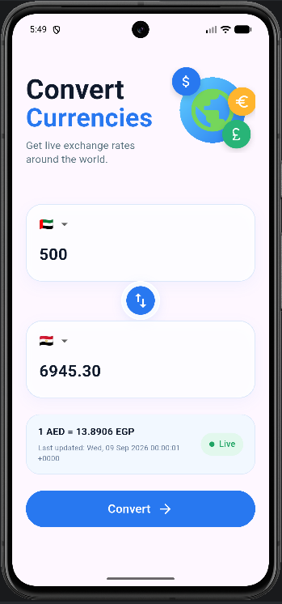

# 💱 Currency Converter

A modern and responsive **Currency Converter App built with Flutter**.

The app allows users to select currencies, enter an amount, swap currencies, and convert using live
exchange-rate data from an external API.

> 🚀 Built as part of my Flutter learning journey, focusing on UI, reusable widgets, API integration,
> and state management.

---

## ✨ Features

- 💱 Currency conversion
- 🌍 Dynamic currency list
- 🚩 Currency names & flags
- 🔄 Swap currencies
- 🧮 Convert on button press
- 📊 Live exchange rate
- 🕒 Last update time
- 📱 Responsive UI
- 🧩 Reusable widgets
- 🔄 Provider & ChangeNotifier
- 🌐 REST API integration

---

## 🛠️ Tech Stack

- **Flutter & Dart**
- **Provider / ChangeNotifier**
- **HTTP**
- **ExchangeRate-API**
- **Flutter ScreenUtil**

---

## 📱 Screenshots

<p align="center">
  
  
  
  
</p>

---

## 🏗️ Project Structure

```text
lib/
│
├── api_service/
│   └── api_service.dart
│
├── constants/
│   ├── Coin.dart
│   ├── currency_constants.dart
│   ├── Flag_constant.dart
│   └── Landmark.dart
│
├── Controllers/
│   └── currency_controller.dart
│
├── models/
│   └── currency_model.dart
│
├── screens/
│   └── CurrencyConverterScreen.dart
│
├── widgets/
│   ├── bottomSection.dart
│   ├── convert_button.dart
│   ├── CurrencyCard.dart
│   ├── CurrencyDropdown.dart
│   ├── ExchangeRateCard.dart
│   ├── header.dart
│   └── SwapButton.dart
│
└── main.dart
```